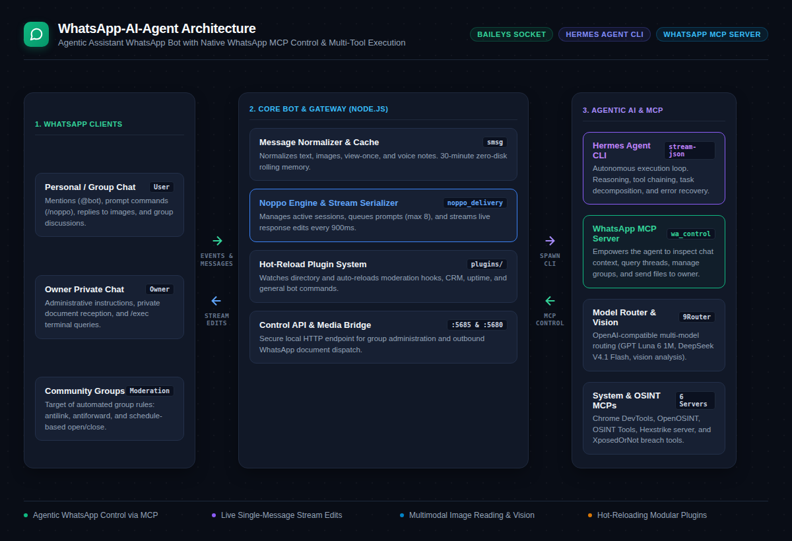

# WhatsApp-AI-Agent

<p align="center">
  
</p>

A WhatsApp bot focused on providing an **autonomous agentic assistant** right inside WhatsApp chats, powered by **Node.js + Baileys** and **Nous Hermes Agent CLI**. 

Instead of acting like a simple question-and-answer chatbot, this bot runs an agentic execution loop capable of multi-step reasoning, tool execution, and self-correction. It comes bundled with a dedicated **WhatsApp Model Context Protocol (MCP) Server**, allowing the AI agent to inspect chat context, check quoted message threads, administer groups, and safely dispatch files back to WhatsApp. 

In addition to its agentic capabilities, it includes standard bot utilities such as group moderation (antilink, antiforward, group scheduling), media utilities, and a modular hot-reloading plugin system.

---

## Table of Contents

- [Core Highlights](#core-highlights)
- [How It Works (Architecture)](#how-it-works-architecture)
- [System Requirements](#system-requirements)
- [Full Setup & Installation Guide](#full-setup--installation-guide)
  - [1. Server Preparation](#1-server-preparation)
  - [2. Clone & Install Dependencies](#2-clone--install-dependencies)
  - [3. Install Hermes Agent CLI](#3-install-hermes-agent-cli)
  - [4. Configure Settings & Models](#4-configure-settings--models)
  - [5. Link WhatsApp via Pairing Code](#5-link-whatsapp-via-pairing-code)
  - [6. Configure the WhatsApp MCP Server](#6-configure-the-whatsapp-mcp-server)
  - [7. Run with PM2 (Background Daemon)](#7-run-with-pm2-background-daemon)
- [Using the Agentic Assistant (Noppo)](#using-the-agentic-assistant-noppo)
- [WhatsApp MCP Server (`wa_control`)](#whatsapp-mcp-server-wa_control)
- [General Bot Features & Commands](#general-bot-features--commands)
- [Plugin System & Hot Reload](#plugin-system--hot-reload)
- [Testing & Verification](#testing--verification)
- [Security & Operational Notes](#security--operational-notes)
- [License & Credits](#license--credits)

---

## Core Highlights

- **Agentic Assistant in WhatsApp**: Uses Hermes Agent CLI to plan, chain tools, run terminal commands, search the web, and solve tasks autonomously.
- **WhatsApp Control via MCP**: Provides a built-in FastMCP server (`wa_control`) so the agent can read chat threads, inspect previous messages, manage group settings, and deliver generated files to the owner.
- **Live Stream Edits**: Responses stream into WhatsApp by editing a single message every 900ms as tokens and tool events arrive, keeping chat logs clean without spamming new messages.
- **Multimodal Vision**: Reads attached images or quoted/replied images and forwards them to vision-capable models for analysis.
- **Pairing Code Setup**: Connect to WhatsApp directly using an 8-character pairing code without needing to scan QR codes via terminal.
- **Zero-Disk Rolling History**: Conversation context is buffered in-memory (rolling 30-minute window) so private messages are not permanently dumped to disk.
- **Hot-Reloading Plugins**: Create or modify `.js` plugin files in `plugins/` and they reload automatically in under 100ms without restarting the bot.
- **Automated Group Moderation**: Built-in antilink, antiforwarding (channel spam blocker), and scheduled group opening/closing.

---

## How It Works (Architecture)

1. **Inbound WhatsApp Layer (`index.js`, `stenly.js`)**:
   - Maintains a stable WebSocket connection using `@itsliaaa/baileys`.
   - Normalizes incoming message formats (text, ephemeral messages, view-once media, voice notes, stickers, reactions).
   - In-memory rolling cache (`lib/message_cache.js`) buffers recent chat history to provide conversation context when replying.

2. **Noppo AI Bridge (`lib/noppo_hermes.js`, `lib/noppo_commands.js`)**:
   - When a user mentions `@bot` or uses `/noppo <prompt>`, the bridge prepares metadata and spawns the Hermes CLI (`hermes chat --format stream-json`).
   - Parses stdout stream events and updates WhatsApp via message edits (`noppo_delivery.js`).

3. **WhatsApp MCP Tool Server (`mcp/wa_control_server.py`)**:
   - Bridges the agent's MCP toolcalls back to WhatsApp through an internal control API (`http://127.0.0.1:5685`).
   - Gives the agent native actions: fetch thread context, get recent chat messages, update group settings, and send generated files safely to the owner.

---

## System Requirements

| Resource | Minimum | Recommended | Notes |
|---|---|---|---|
| **CPU** | 2 vCPU cores | 4 vCPU cores | Sufficient for running Node.js + Hermes background jobs |
| **RAM** | 2 GB | 4 GB | 4 GB recommended if using browser/Chromium tools |
| **Storage** | 10 GB SSD | 20 GB SSD | For Node modules, Python venvs, and cache |
| **OS** | Linux | Ubuntu 22.04 / 24.04 LTS or Debian 12 | Linux environment recommended |
| **Node.js** | `>= 18.18.0` | Node.js 20 LTS or 22 LTS | Tested on Node 20 & 22 |
| **Python** | `>= 3.10` | Python 3.11 / 3.12 | Required for the MCP server |

---

## Full Setup & Installation Guide

### 1. Server Preparation

Update package repositories and install the necessary system packages:

```bash
sudo apt update && sudo apt upgrade -y
sudo apt install -y curl wget git build-essential ffmpeg jq python3 python3-pip python3-venv
```

Install Node.js (v22 LTS recommended) and PM2:

```bash
curl -fsSL https://deb.nodesource.com/setup_22.x | sudo -E bash -
sudo apt install -y nodejs
sudo npm install -g pm2
```

---

### 2. Clone & Install Dependencies

Clone this repository and install Node.js dependencies:

```bash
git clone https://github.com/glarceny/WhatsApp-AI-Agent.git /LlamaAgentHermes
cd /LlamaAgentHermes
npm install
```

---

### 3. Install Hermes Agent CLI

Install Hermes Agent CLI globally:

```bash
curl -fsSL https://hermes.nousresearch.com/install.sh | bash
```

Verify installation:

```bash
hermes --version
```

Synchronize the system agent persona and instructions:

```bash
mkdir -p /root/.hermes
cp /LlamaAgentHermes/Hermes-kit/SOUL.md /root/.hermes/SOUL.md
```

Create `/root/.hermes/noppo.env` for model routing authentication:

```bash
cat << 'EOF' > /root/.hermes/noppo.env
NOPPO_ROUTER_API_KEY=your_api_key_here
EOF
chmod 600 /root/.hermes/noppo.env
```

---

### 4. Configure Settings & Models

#### Owner & Bot Settings
Edit `control/settings.js` to configure your WhatsApp owner numbers:

```javascript
global.namaown = "Your Name";
global.prefix = "/";
global.botname = "Noppo Agent";
global.botversion = "v1.0";
global.owner = ["6285199430173", "6285881325696"]; // Owner numbers in international format (no '+')
```

#### Model Router Configuration
Edit `lib/noppo_config.js` to configure your model endpoints (OpenAI-compatible / 9Router / OpenRouter):

```javascript
module.exports = {
    provider: {
        baseUrl: process.env.NOPPO_ROUTER_URL || 'https://9router.stenly.id/v1',
        apiKeyEnv: 'NOPPO_ROUTER_API_KEY',
        credentialsFile: '/root/.hermes/noppo.env'
    },
    models: [
        { id: 'cx/gpt-6-luna[1m]', name: 'GPT Luna 6 (1M)', provider: 'openai', supportsVision: true },
        { id: 'dco/deepseek-ai/DeepSeek-V4.1-Flash-1017', name: 'DeepSeek V4.1 Flash', provider: 'openai', supportsVision: true }
    ],
    defaultModelId: 'cx/gpt-6-luna[1m]'
};
```

---

### 5. Link WhatsApp via Pairing Code

Run the bot directly in your terminal to pair your WhatsApp account:

```bash
PAIRING_NUMBER=6283167054726 node index.js
```

The terminal will display a pairing code:

```text
=================================
PAIRING CODE:  STENLYCL 
=================================
Buka WhatsApp > Perangkat Tertaut > Tautkan Perangkat > masukkan kode di atas.
```

1. Open **WhatsApp** on your phone.
2. Go to **Settings** > **Linked Devices**.
3. Select **Link a Device** > **Link with phone number instead**.
4. Type in the code displayed in your terminal.
5. Once connected, press `Ctrl+C` to stop the interactive run.

---

### 6. Configure the WhatsApp MCP Server

Add the `wa_control` MCP server to `/root/.hermes/config.yaml` so Hermes can use WhatsApp tools:

```yaml
mcp_servers:
  wa_control:
    command: "/usr/bin/python3"
    args:
      - "/LlamaAgentHermes/mcp/wa_control_server.py"
```

Verify that the MCP server runs and connects to the bot's internal control API:

```bash
python3 /LlamaAgentHermes/mcp/smoke_test.py
```

---

### 7. Run with PM2 (Background Daemon)

Start the bot with PM2 so it stays online:

```bash
pm2 start index.js --name llama-hermes
pm2 save
pm2 startup
```

Useful PM2 commands:

```bash
# Check status
pm2 status

# View logs without freezing the terminal
pm2 logs llama-hermes --nostream --lines 40

# Restart bot
pm2 restart llama-hermes
```

---

## Using the Agentic Assistant (Noppo)

You can interact with the agent in any chat where the bot is present:

- **Direct Mention**: Mention the bot with a prompt:
  ```text
  @bot Analyze why our payment webhook timed out and check recent logs.
  ```
- **Command Prefix**:
  ```text
  /noppo Search for the latest security advisories regarding OpenSSH.
  ```
- **Quoted Context**: Reply to any message or image and mention `@bot` to ask questions about it.

### Agent Commands
- `/noppo new`: Clear conversation memory and start a fresh session.
- `/noppo model`: List available LLM models and switch between them.
- `/noppo status`: Check active turn status, session IDs, and token usage.
- `/noppo stop`: Gracefully stop the currently running agent turn.

---

## WhatsApp MCP Server (`wa_control`)

The bundled WhatsApp MCP server exposes actions to the agent:

| Tool Name | Description |
|---|---|
| `wa_message_thread` | Reads quoted message chains and context around a specific message. |
| `wa_message_recent` | Retrieves recent messages from a chat to understand ongoing discussions. |
| `wa_message_search` | Searches cached messages in a chat by keyword, sender, or media name. |
| `wa_message_fetch` | Requests older historical messages on demand directly from WhatsApp. |
| `wa_group_list` | Lists groups joined by the bot with metadata and admin status. |
| `wa_group_info` | Inspects detailed group settings, description, and member counts. |
| `wa_group_setting` | Toggles group settings (e.g. restrict announcement-only mode). |
| `send_document` | Dispatches generated documents (code, logs, archives) to the owner's private chat. |

---

## General Bot Features & Commands

Besides the AI agent, the bot includes general utilities:

- **Group Moderation**:
  - `/antilink on|off`: Automatically deletes group invite links.
  - `/antiforward on|off`: Blocks broadcast/channel forwarded messages.
  - `/closegroup <time>`: Schedules opening and closing of group chat permissions.
- **Administration**:
  - `/exec <bash>`: Runs terminal commands (restricted strictly to owner numbers).
  - `/modebot public|self|self2`: Changes bot mode (`self` = private only, `self2` = silent moderation).
  - `/addown <number>`: Adds an owner number.
  - `/uptime`: Displays VPS uptime and system memory stats.
- **Media Utilities**:
  - `/hd`: Enhances image resolution.
  - Media Store: Saves media attachments sent in groups into an indexed media archive.

---

## Plugin System & Hot Reload

New commands or event listeners are placed in `plugins/`:

```javascript
module.exports = {
    name: 'ping',
    command: ['ping', 'p'],
    category: 'main',
    description: 'Check bot latency',
    owner: false,
    group: false,
    admin: false,
    run: async (context) => {
        const { m } = context;
        const latency = Date.now() - m.messageTimestamp * 1000;
        await m.reply(`Pong! Latency: ${latency}ms`);
    }
};
```

Any changes made inside `plugins/` take effect in **under 100ms** automatically without restarting the bot.

---

## Testing & Verification

The repository includes 13 Node.js test suites testing Baileys protocol normalization, message cache, anti-forward logic, and Hermes streaming:

```bash
node --test test/*.test.js
```

All 13 test suites should pass cleanly:

```text
ℹ tests 13
ℹ suites 0
ℹ pass 13
ℹ fail 0
```

---

## Security & Operational Notes

- **Credential Safety**: Authentication tokens and WhatsApp sessions are kept in `session/` and `control/control_token`. The `.gitignore` prevents them from being committed.
- **Document Routing Guard**: The agent's instructions prevent it from posting raw documents, archives, or sensitive files into public groups; file deliveries default to the owner's private chat.
- **Owner Verification**: Sensitive commands (`/exec`, `/modebot`, `/addown`) verify the sender's phone number and LID against `global.owner` before executing.

---

## License & Credits

- **License**: MIT
- **Author**: Stenly Christian ([@glarceny](https://github.com/glarceny))
- **Core Libraries**: [@itsliaaa/baileys](https://github.com/itsliaaa/baileys) & [Nous Research Hermes](https://github.com/NousResearch/Hermes-Agent)
EOF
